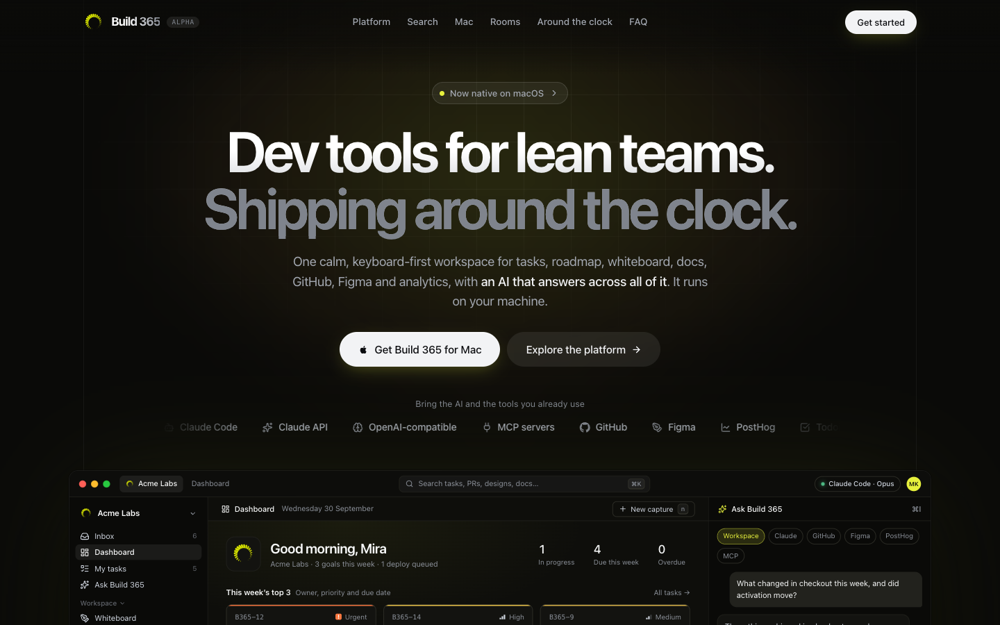

# Build 365: the website

**Dev tools for lean teams. Shipping around the clock.**

**Live:** [kamal007olica.github.io/Build365-site](https://kamal007olica.github.io/Build365-site/)

> **Built a tool to build ZenMode OS.** Build 365 is the workspace I made so a small team can plan, design, code and ship [ZenMode OS](https://github.com/Kamal007OLica/zenmode), a minimalist Android launcher, from one calm, keyboard-first place.



This repo is the marketing site for Build 365: one workspace for tasks, roadmap, whiteboard, knowledge base, GitHub, Figma, analytics and an AI that answers across all of them. It is self-hosted and local-first.

Full page: [docs/snapshot-full.png](docs/snapshot-full.png)

## What Build 365 is

Rooms that turn an outcome into tickets and workers, a vertical-slice Plan, Platforms for Android, iOS and web releases, an inbox for captures, a whiteboard, a knowledge base, and an Ask box that cites its sources. The app itself lives in a separate, private repo; this repo is only the site.

## Pricing

- **Self-hosted:** free forever. Every feature, unlimited seats, no gates.
- **Enterprise:** ₹899 a seat a month billed yearly (₹1,099 monthly), GST included, no minimum seats, volume pricing from 50. Hosting, security and support handled for you.
- **Tamil Nadu founders' programme:** StartupTN or DPIIT recognised startups headquartered in Tamil Nadu get Enterprise free for 12 months, then half price until ₹1 crore ARR. Students, college incubators and accelerator cohorts get it at ₹0.

Prices live in the `PRICE` const at the top of `src/sections/Pricing.tsx`.

## Run it

```sh
npm install
npm run dev          # http://localhost:5180
npm run build        # static site in dist/
npm run typecheck
```

`SITE_BASE` sets the path the site is served from (`/` on a custom domain, `/<repo>/` on GitHub Pages) and `SITE_URL` its public address. Pushing to `main` deploys to GitHub Pages.

## Layout

| Path | What |
| --- | --- |
| `src/sections/` | Page sections: nav, hero stage, platform, rooms, clock, pricing, FAQ, footer |
| `src/ui/` | Shared pieces: logo, intro, product mock-ups |
| `shared/` | The few app components and design tokens the mock-ups reuse |
| `public/` | Icons, social image, manifest |

---

Made by [Kamalraaj](https://www.justkamalthings.com/).
